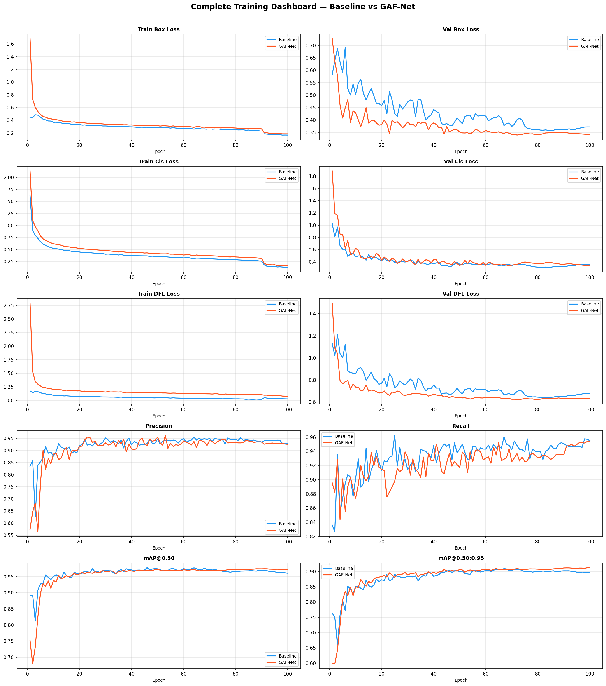
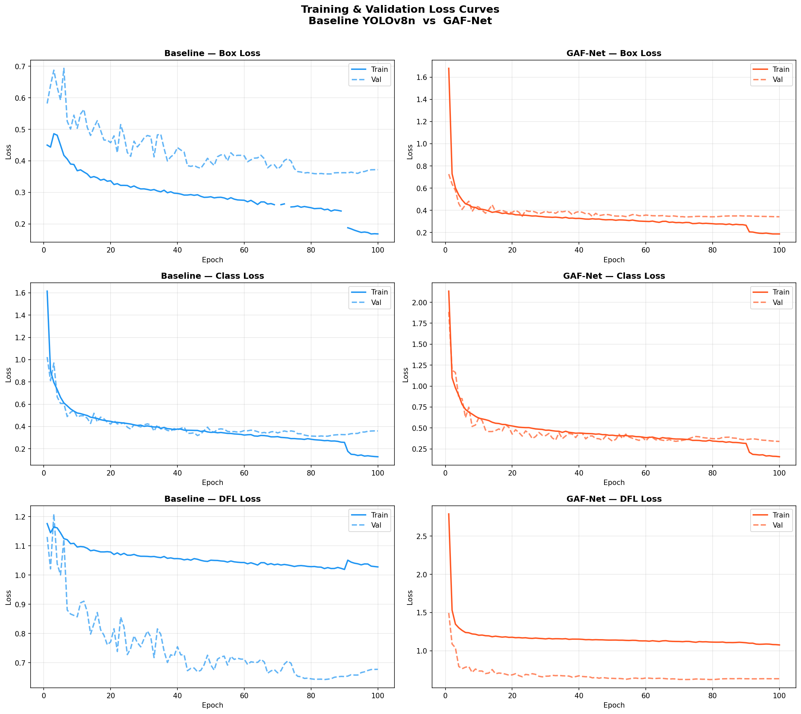
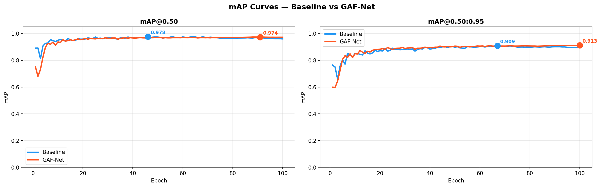
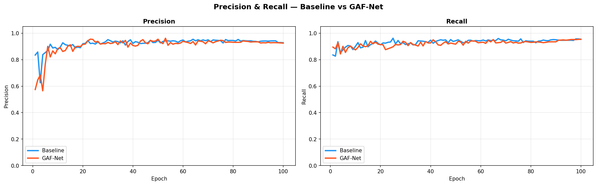
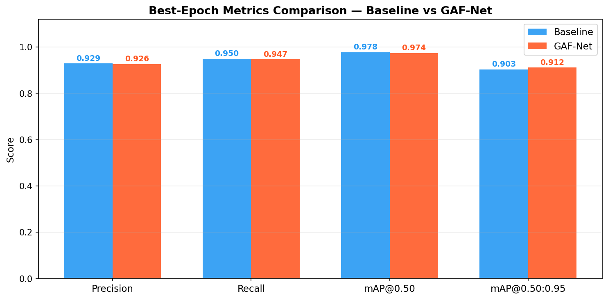
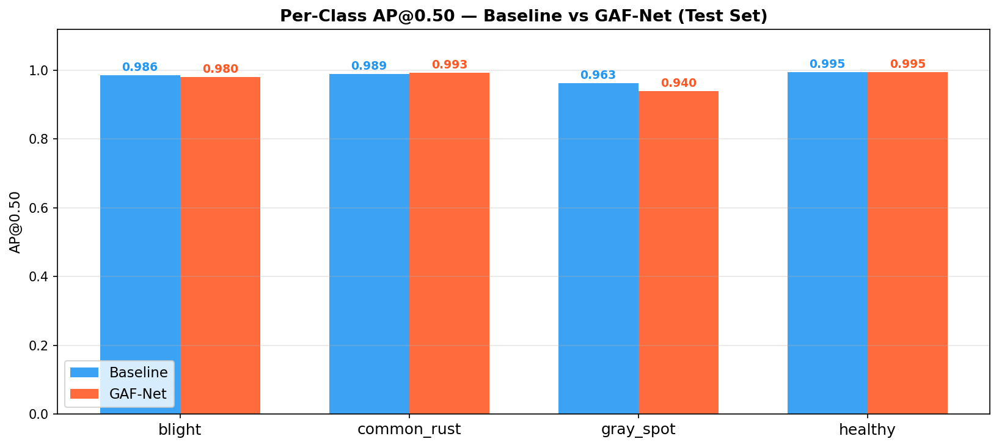

# GAF Net Multi Disease Corn Leaf Detection using Modified-YOLOv8 with GSConv & FASFF (Feature Adaptive Spatial Feature Fusion)


This project presents an end‑to‑end object detection pipeline for **multi‑disease corn leaf detection**, built on **YOLOv8** and enhanced with two key architectural improvements:

- **GSConv** (lightweight convolution) to improve efficiency while maintaining representational power.
- **FASFF / FASF** (Feature Adaptive Spatial Feature Fusion) to strengthen multi‑scale feature fusion and improve detection performance, especially for small/medium lesions.

It includes:
- A complete **execution notebook**: `multiple-corn-disease.ipynb`
- A full **project report (PDF)**: `Corn Disease Detection - Report.pdf`
- Trained **weights** (`best.pt.zip`) and baseline weights (`yolov8n.pt.zip`)
- A `results/` folder containing all major **plots and evaluation visualizations**.

---

## 1. Project Motivation

Corn leaf diseases significantly reduce yield and quality. Manual scouting is time‑consuming and error‑prone. This work focuses on building an accurate and practical detector that can **localize and classify multiple disease types** in field-like images using a modified YOLOv8 framework (GAF‑Net).

---

## 2. Key Contributions (What’s New)

### 2.1 Baseline
- Baseline model: **YOLOv8n** (lightweight YOLOv8 nano)

### 2.2 Proposed: GAF‑Net (Modified YOLOv8)
- Integrates **GSConv** to improve efficiency and feature extraction.
- Uses **Feature Adaptive Spatial Feature Fusion (FASFF/FASF)** for stronger multi‑scale fusion (better performance on disease spots of varying sizes).

---

## 3. Repository Contents

### 3.1 Notebook (Execution Code)
- **`multiple-corn-disease.ipynb`**  
  This notebook is the main end‑to‑end executable workflow. It typically covers:
  - Environment & dependency setup
  - Dataset preparation and configuration
  - Training baseline YOLOv8n
  - Training the proposed GAF‑Net
  - Validation and metric extraction
  - Plotting and comparing curves (loss, mAP, precision, recall)
  - Exporting results and weights

### 3.2 Report
- **`Corn Disease Detection - Report.pdf`**  
  Contains the full documentation of:
  - Problem statement & objectives
  - Literature / baseline discussion
  - Methodology and architecture changes (GSConv + FASFF)
  - Training setup (epochs, optimizer settings, augmentation, etc.)
  - Results analysis and discussion
  - Conclusions & future scope

### 3.3 Weights
- **`best.pt.zip`**: best trained checkpoint for the proposed model (GAF‑Net)  
- **`yolov8n.pt.zip`**: baseline pretrained YOLOv8n weights archive

### 3.4 Results (Plots)
All key plots are in `results/`:

- `results/plot_full_dashboard.png`  
- `results/plot_loss_curves.png`  
- `results/plot_map_curves.png`  
- `results/plot_metrics_bar_comparison.png`  
- `results/plot_precision_recall.png`  
- `results/plot_per_class_ap50.png`  

---

## 4. Visual Results (Plots in this Repo)

### 4.1 Complete Training Dashboard (Baseline vs GAF‑Net)


This dashboard summarizes:
- Train/Val **Box Loss**, **Cls Loss**, **DFL Loss**
- **Precision**, **Recall**
- **mAP@0.50** and **mAP@0.50:0.95**
with a direct comparison between **Baseline YOLOv8n** and **GAF‑Net**.

### 4.2 Loss Curves (Train vs Validation) — Baseline vs GAF‑Net


Shows how training and validation losses evolve across epochs, useful for diagnosing:
- convergence speed
- generalization gap
- stability of optimization

### 4.3 mAP Curves


Tracks mAP improvement over epochs (typically includes mAP@0.50 and mAP@0.50:0.95).

### 4.4 Precision–Recall Curve


Used to assess tradeoff across confidence thresholds and overall detection quality.

### 4.5 Metric Comparison (Bar Plot)


A compact view comparing baseline vs GAF‑Net across major metrics.

### 4.6 Per-Class AP@0.50


Shows class-wise detection performance and highlights which diseases benefit most from the architecture changes.

---

## 5. How to Run (End‑to‑End)

### 5.1 Environment Setup
Create a Python environment (recommended):
```bash
conda create -n gafnet python=3.10 -y
conda activate gafnet
```

Install common dependencies (typical for YOLOv8 workflows):
```bash
pip install ultralytics opencv-python matplotlib seaborn numpy pandas
```

> Note: The notebook may include additional installs (e.g., torch/torchvision) depending on runtime (local vs Colab).

### 5.2 Run the Notebook
Open and run:
- `multiple-corn-disease.ipynb`

Recommended execution order:
1. Setup & imports
2. Dataset configuration
3. Baseline training (YOLOv8n)
4. GAF‑Net training (modified model)
5. Validation & metric extraction
6. Plot generation (saved in `results/`)

---

## 6. Models compared

### Baseline
- **YOLOv8n (Ultralytics)**

### Proposed: GAF‑Net
A modified YOLOv8 architecture incorporating:
- **GSConv** (lightweight convolution variant)
- **FASFF/FASF** (adaptive spatial feature fusion across feature pyramid levels)

**Goal of the modification:** improve detection robustness and localization under strict evaluation (notably **mAP@0.50:0.95**), while keeping the detector efficient.

----

## 7. Training & Evaluation summary

### 7.1 Overall metrics (Best epoch)

These values are the **final best-epoch** comparison reported in the project results.

| Metric | Baseline (YOLOv8n) | GAF‑Net |
|---|---:|---:|
| **Precision** | **0.929** | **0.926** |
| **Recall** | **0.950** | **0.947** |
| **mAP@0.50** | **0.978** | **0.974** |
| **mAP@0.50:0.95** | **0.903** | **0.912** |

**Key takeaway (as observed in results):**
- Baseline YOLOv8n is **slightly higher** in **precision** and **recall**.
- **GAF‑Net is higher in mAP@0.50:0.95 (0.912 vs 0.903)**, which indicates **better localization quality** under stricter IoU thresholds.

### 7.2 Computed F1 (Best epoch)

| Model | F1 (computed) |
|---|---:|
| **Baseline (YOLOv8n)** | **≈ 0.939** |
| **GAF‑Net** | **≈ 0.936** |

Interpretation:
- F1 is very close across both models, consistent with the near-identical precision/recall values.
- The main differentiator is **stricter localization performance** (mAP@0.50:0.95) favoring **GAF‑Net**.

### 7.3 Per‑class AP@0.50 (Class‑wise performance)

Reported AP@0.50 per class:

| Class | Baseline AP@0.50 | GAF‑Net AP@0.50 |
|---|---:|---:|
| **Blight** | **0.986** | **0.980** |
| **Common Rust** | **0.989** | **0.993** |
| **Gray Spot** | **0.963** | **0.940** |
| **Healthy** | **0.995** | **0.995** |

**Notes (from the reported behavior):**
- **Common Rust** improves with GAF‑Net (0.993 vs 0.989).
- **Healthy** remains perfectly stable across both.
- While the AP@0.50 table shows a drop for **Gray Spot** at IoU=0.50, the confusion matrix analysis below indicates **Gray Spot detection correctness improves** in GAF‑Net (more correct predictions), and the overall improvement appears under stricter evaluation (**mAP@0.50:0.95**).

Plot available in repo:
- `results/plot_per_class_ap50.png`

---


## 8. Confusion Matrix Summary 

This section summarizes the class-wise correct detections and notable confusions.

### 8.1 Baseline (YOLOv8n) — key counts


**Blight**
- Correct: **107**
- Misclassified as:
  - Gray Spot: **11**
  - Background: **14**

**Common Rust**
- Correct: **128** (very strong)

**Gray Spot**
- Correct: **56**
- Confused with:
  - Blight: **4**

**Healthy**
- Correct: **106** (perfect detection)

### 8.2 GAF‑Net — key counts

**Blight**
- Correct: **109**
- Reduced misclassification vs baseline

**Common Rust**
- Correct: **128** (same strong performance)

**Gray Spot**
- Correct: **61** (**improved** vs baseline 56)

**Healthy**
- Correct: **106** (perfect)

**Interpretation (what this indicates):**
- GAF‑Net improves correctness for **Gray Spot** (61 vs 56), which is typically a challenging class.
- Improvements are consistent with the idea that GAF‑Net yields **more robust detection under stricter evaluation conditions**, matching the observed **mAP@0.50:0.95 increase**.

---

## 9. Artifacts and Reproducibility

### Included artifacts
- Final weights: `best.pt.zip`
- Visuals: `results/*.png`
- Full documentation: `Corn Disease Detection - Report.pdf`

### Suggested additions (optional but recommended)
If you plan to extend this repo, consider adding:
- `requirements.txt`
- dataset YAML sample (e.g., `data.yaml`)
- inference script for images/videos
- a small demo folder with example images

---

## 10. Citation / Acknowledgements

- YOLOv8 / Ultralytics ecosystem for training and evaluation pipeline.
- Standard object detection metrics: Precision, Recall, mAP.

---

## 11. Quick Links (Repo Files)

- Notebook: `multiple-corn-disease.ipynb`  
- Report: `Corn Disease Detection - Report.pdf`  
- Results plots: `results/`  
- Best weights: `best.pt.zip`  
- Baseline weights and model: `yolov8n.pt.zip`  

---


